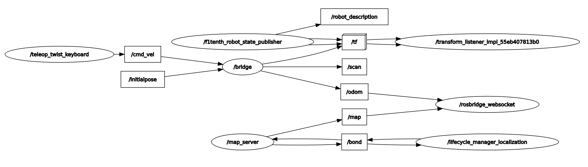

# F1Tenth Simulator
Containerized bridge node for the F1Tenth gym environment that turns it into a simulation in ROS2 Humble.




## Instruction
Please install the [Docker](https://docs.docker.com/engine/install/) and [Docker Compose](https://docs.docker.com/compose/install/) before running the simulation. On the first use, build the container image is required:

```
docker compose up --build
```

It will build the ROS2 Humble environment, install required dependencies, build the workspace for bridge packages, and launch the simulation stack automatically. After the image is built, in next time, you can simply run 

```
docker compose up
```

And remember to stop the container after each simulation.

```
docker compose down
```

The stack will launches F1Tenth gym simulation, map server, bridge node, RViz2, and a dummy planner node.

If you are running additional ROS2 nodes in WSL2, you must configure the correct DDS middleware environment. Before running any external ROS2 node, execute:

```
chmod +x script/setup_env.sh
source script/setup_env.sh
```

This ensures:
- `RMW_IMPLEMENTATION=rmw_cyclonedds_cpp`
- `ROS_DOMAIN_ID=0`
- `ROS_LOCALHOST_ONLY=0`

Without this step, DDS discovery between Docker and native ROS2 nodes may fail. You must run this in each new terminal session before launching ROS2 nodes.

## Dummy Planner

A dummy planner node is included in the simulation stack for controller and user interface testing. The node will subscribe `/pf/pose/odom` and `/clicked_point` from RViz2, connects the current robot pose to the clicked point, generates a simple straight-line path, and then publish `/planning/path` topic.

## Keyboard Teleop
The keyboard teleop node from `teleop_twist_keyboard` is also installed as part of the simulation's dependency. To enable keyboard teleop, set `kb_teleop` to True in `bridge.yaml`. After launching the simulation, in another terminal, run:

```
ros2 run teleop_twist_keyboard teleop_twist_keyboard
```